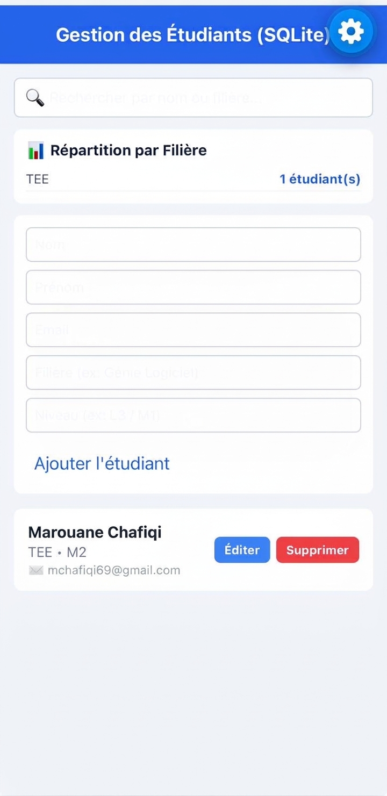

# Lab 14 : Gestion des étudiants (SQLite + React Native)



Application mobile qui gère des **étudiants** dans une base SQLite locale.

## Ce que fait l'application

- Ajouter, modifier et supprimer un étudiant
- Rechercher par nom ou par filière
- Afficher des statistiques par filière
- Fonctionner hors ligne

## Installation

```
npx create-expo-app@latest Lab14App --template blank
cd Lab14App
npx expo install expo-sqlite
```

Copier les dossiers `database`, `services`, `components` et le fichier `App.js` de ce projet dans `Lab14App` (remplacer `App.js`), puis :

```
npx expo start
```

Scanner le QR code avec **Expo Go**.

## Fichiers

- `App.js` : écran principal
- `database/database.js` : connexion et table SQLite
- `services/studentService.js` : requêtes SQL
- `components/` : formulaire, liste, recherche, statistiques
